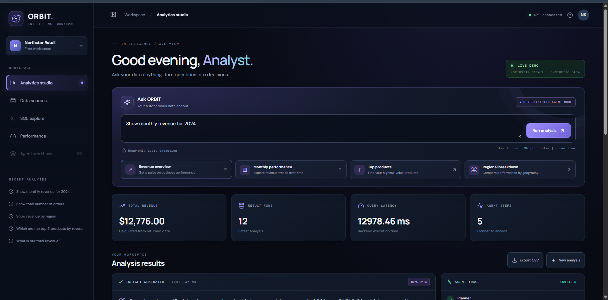
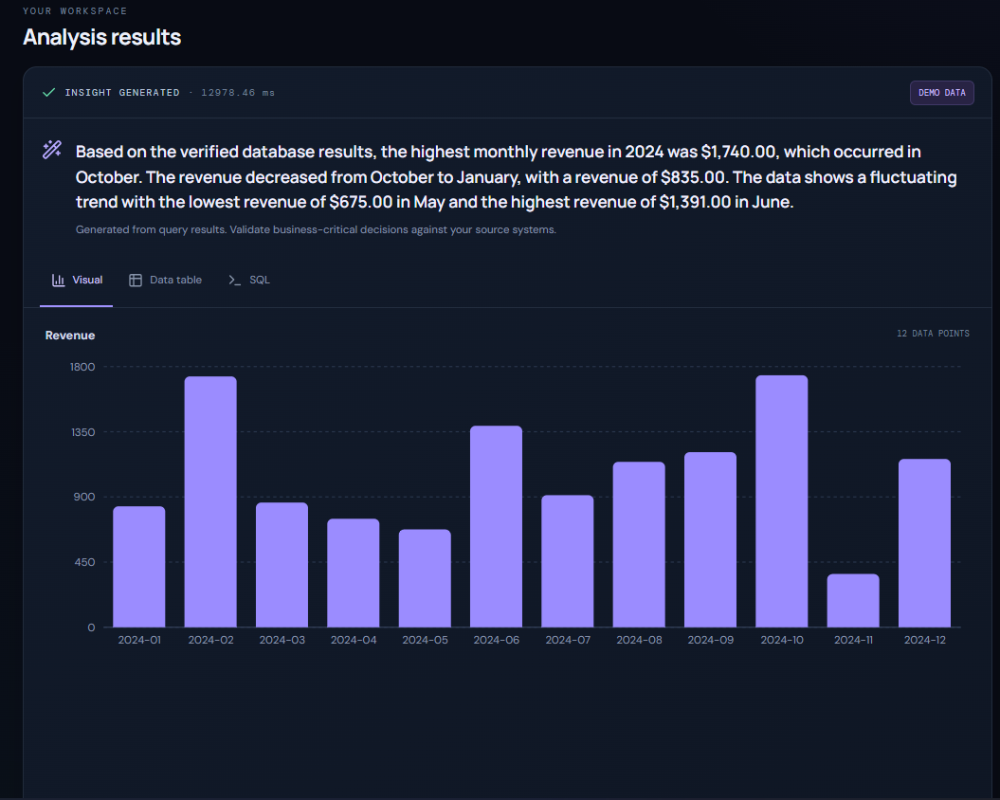
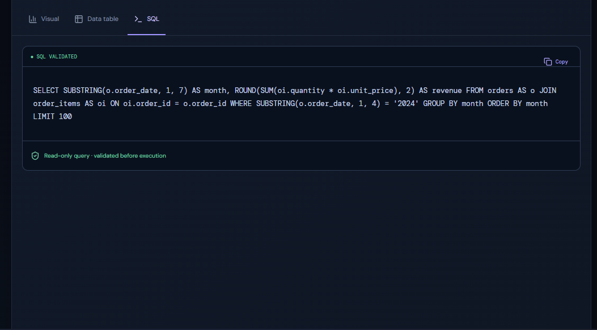
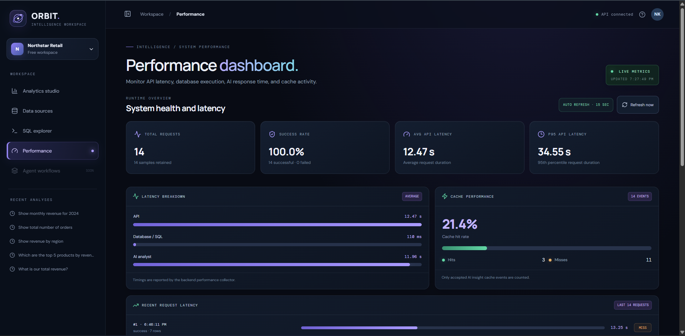
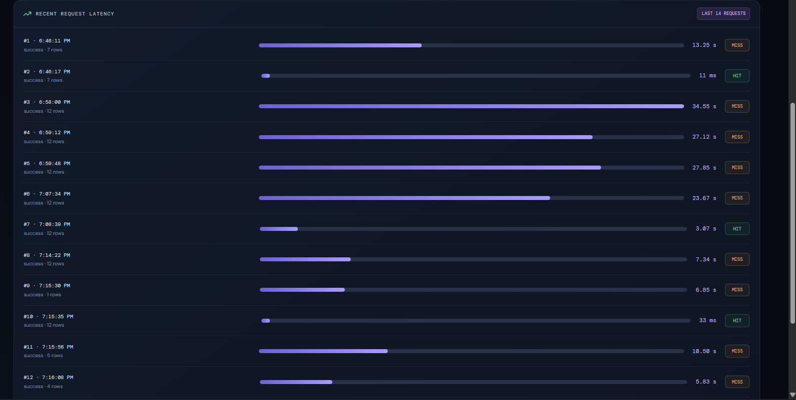
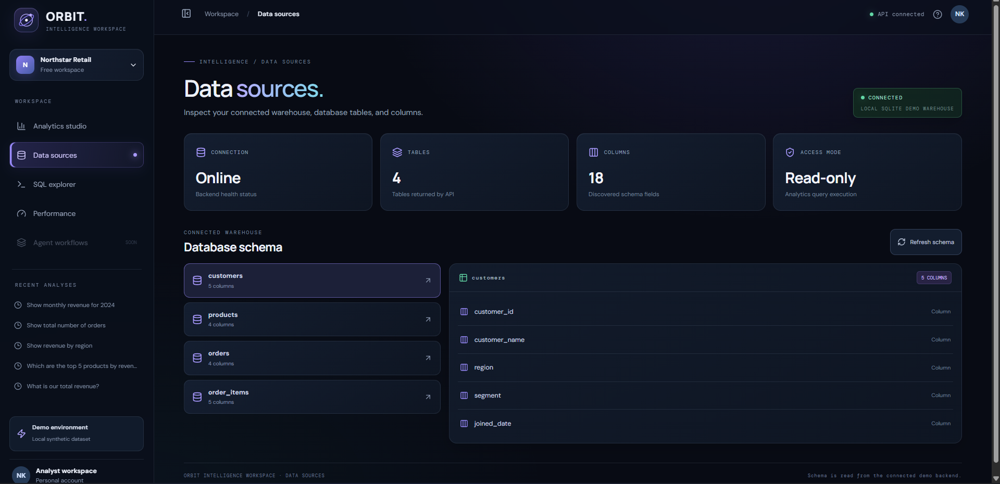
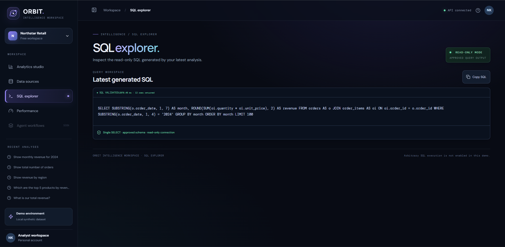

# ORBIT Analytics Agent

<<<<<<< Updated upstream
**A natural-language analytics platform for querying business data and generating interactive insights.**

ORBIT Analytics Agent is a full-stack analytics application that enables users to ask business questions in natural language and receive structured results, visualizations, and generated SQL queries.

Instead of manually writing SQL queries, users can explore business data through a conversational analytics interface.
=======
An AI-assisted analytics workspace that transforms natural-language business questions into safe SQL queries, structured results, interactive visualizations, and performance insights.

<p align="center">
  <strong>React · TypeScript · FastAPI · SQLite · Ollama · Recharts</strong>
</p>

ORBIT is a local-first AI-assisted analytics platform designed to simplify business data exploration. It combines deterministic query planning, SQL safety validation, SQLite data retrieval, optional local LLM-powered business insights, and request-level performance monitoring.
>>>>>>> Stashed changes

---

## Screenshots

### 1. Analytics Workspace

The main workspace for asking natural-language business questions and exploring analytical results.



<<<<<<< Updated upstream
The application processes supported questions, identifies the relevant analytics operation, generates an approved SQL query, executes it against the database, and displays the results.
=======
### 2. Analysis Results and Agent Trace
>>>>>>> Stashed changes

Displays generated analytical results, visualizations, and the workflow execution trace.

<<<<<<< Updated upstream
- **Natural Language Analytics** – Ask business questions using everyday language.
- **Automated SQL Generation** – Generate SQL queries for supported analytics questions.
- **Interactive Visualizations** – Explore results through charts and graphs.
- **KPI Metrics** – Display important business metrics.
- **Data Source Explorer** – Inspect database tables and schema information.
- **SQL Explorer** – View and copy generated SQL queries.
- **Query History** – Access previous analytics requests.
- **CSV Export** – Export query results.
- **SQL Validation** – Apply read-only query validation before execution.
- **Agent Execution Trace** – View the workflow used to process a query.
=======

>>>>>>> Stashed changes

### 3. Query Performance

<<<<<<< Updated upstream
| Layer | Technologies |
|---|---|
| Frontend | React.js, TypeScript, Vite |
| Styling | CSS |
| Charts | Recharts |
| Icons | Lucide React |
| Backend | Python, FastAPI |
| Database | SQLite |
| API | REST API |
| Server | Uvicorn |
| Containerization | Docker, Docker Compose |

## Architecture

```text
                  USER
                    |
                    v
           React Analytics UI
                    |
                    v
               FastAPI API
                    |
                    v
           Analytics Workflow
                    |
          +---------+---------+
          |         |         |
          v         v         v
       Planner  SQL Safety  Executor
          |         |         |
          +---------+---------+
                    |
                    v
             SQLite Database
                    |
                    v
         Results & Visualizations
                    |
                    v
             React Dashboard
=======
Shows query-level execution performance and timing information.



### 4. Performance Dashboard

Provides an overview of API latency, SQL execution time, AI generation time, success rate, and cache performance.



### 5. Performance History

Displays recent request history, latency information, and cache HIT/MISS activity.



### 6. Data Sources and Schema Explorer

Shows the available data sources and database schema information.



### 7. SQL Explorer

Provides an interface for exploring and validating analytical SQL queries.



---

## Key Features

- **Natural-Language Analytics:** Ask business questions using everyday language.
- **Read-Only SQL Workflow:** Build and validate approved analytical queries before execution.
- **Business Insights:** Generate summaries and explanations from analytical results.
- **Interactive Visualizations:** Display analytical results using Recharts.
- **Agent Trace:** Track workflow stages from query planning through business analysis.
- **Local LLM Integration:** Integrate Ollama with the `qwen2.5:1.5b` model.
- **Additional Local Models:** Development environment also includes `llama3.2:3b` and `nomic-embed-text`.
- **Deterministic Fallback:** Keep supported analytical workflows usable when Ollama is unavailable or times out.
- **Response Caching:** Cache accepted AI insights for repeated requests.
- **Single-Flight Request Deduplication:** Coalesce concurrent identical requests to avoid duplicate model generations.
- **Performance Monitoring:** Track request count, success rate, average latency, P95 latency, SQL duration, AI duration, and cache hit rate.
- **Request History:** Inspect recent request latency and cache activity.
- **CSV Export:** Export analysis results from the workspace.

> **AI transparency:** Deterministic fallback responses are different from LLM-generated insights. The application should identify which mode produced the response.

---

## Architecture

```mermaid
flowchart TD
    U[User] --> FE[React + TypeScript + Vite]
    FE --> API[FastAPI REST API]

    API --> PLAN[Query Planner]
    PLAN --> BUILD[SQL Builder]
    BUILD --> SAFE[SQL Safety Validation]

    SAFE --> DB[(SQLite Analytics Database)]
    DB --> RESULT[Query Results]

    RESULT --> AI[Business Analyst]
    AI <--> CACHE[Accepted-Answer Cache]
    AI <--> OLLAMA[Ollama Local Model]

    RESULT --> CHART[Chart Data]
    AI --> RESPONSE[Analysis Response]
    CHART --> RESPONSE

    RESPONSE --> FE

    API --> METRICS[Performance Collector]
    METRICS --> DASH[Performance Dashboard]
>>>>>>> Stashed changes
```

---

## Request Lifecycle

1. The user submits a business question through the React workspace.
2. FastAPI receives the request and coordinates the analytical workflow.
3. The query planner identifies the requested metrics and dimensions.
4. The SQL builder creates a query using supported query patterns.
5. The SQL safety layer validates the query before execution.
6. SQLite returns the requested analytical data.
7. The business analyst attempts to generate an insight using the local Ollama model.
8. If the model is unavailable or times out, a supported deterministic fallback can be used.
9. The API returns the answer, result rows, chart data, agent trace, and timing information.
10. The performance collector records request-level metrics for the dashboard.

---

## Technology Stack

| Layer | Technologies |
|---|---|
| Frontend | React 18, TypeScript, Vite |
| UI and Charts | CSS, Recharts, Lucide React |
| Backend | Python, FastAPI, Uvicorn |
| Database | SQLite |
| AI Runtime | Ollama |
| Local Models Used in Development | qwen2.5:1.5b, llama3.2:3b, nomic-embed-text |
| Testing | pytest |
| Performance | SQLite indexes, bounded in-memory metrics, accepted-answer cache, single-flight deduplication |

---

## Project Structure

```text
orbit-analytics-agent/
│
├── .github/
│   └── workflows/
│
├── backend/
<<<<<<< Updated upstream
│
├── frontend/
│
├── docs/
│
=======
│   ├── app/
│   │   ├── main.py
│   │   └── ...
│   ├── tests/
│   ├── benchmark_queries.py
│   ├── benchmark_ollama.py
│   └── requirements.txt
│
├── docs/
│   └── screenshots/
│       ├── 01-analytics-studio.png
│       ├── 02-analysis-results.png
│       ├── 03-query-performance.png
│       ├── 04-performance-dashboard.png
│       ├── 05-performance-history.png
│       ├── 06-data-sources.png
│       └── 07-sql-explorer.png
│
├── frontend/
│   ├── src/
│   │   ├── components/
│   │   ├── App.tsx
│   │   └── ...
│   ├── package.json
│   └── vite.config.ts
│
>>>>>>> Stashed changes
├── .env.example
├── .gitignore
├── docker-compose.yml
└── README.md
```

---

## Prerequisites

<<<<<<< Updated upstream
- Python 3.10+
- Node.js 20+
- npm
- Git
=======
Install the following before running ORBIT:

- Python 3.10
- Node.js and npm
- Ollama (optional, for local LLM-powered insights)

The deterministic workflow can still be used when Ollama is unavailable, subject to the supported query flow.

---

## Installation and Setup
>>>>>>> Stashed changes

### 1. Clone the Repository

```bash
git clone https://github.com/Nithish464/orbit-analytics-agent.git
<<<<<<< Updated upstream
=======

>>>>>>> Stashed changes
cd orbit-analytics-agent
```

### 2. Configure the Backend

```bash
cd backend

python -m venv .venv

.venv\Scripts\activate

pip install -r requirements.txt
```

If your local configuration requires environment variables, copy `.env.example` to `.env` and configure the required values.

Never commit `.env` files or API keys to GitHub.

### 3. Start the Backend

```bash
python -m uvicorn app.main:app --reload
```

Backend endpoints:

| Service | URL |
|---|---|
| API Base | http://127.0.0.1:8000 |
| API Documentation | http://127.0.0.1:8000/docs |
| Performance Metrics | http://127.0.0.1:8000/api/performance |

Add the health-check URL here after verifying the actual route in the backend.

### 4. Configure Ollama (Optional)

Install Ollama and start its service.

Pull the configured local model:

```bash
ollama pull qwen2.5:1.5b
```

Additional models used in the development environment:

```bash
ollama pull llama3.2:3b

ollama pull nomic-embed-text
```

Ensure that the model configured in the backend matches the model available in Ollama.

Do not start a second Ollama server if the Ollama service is already running.

### 5. Start the Frontend

<<<<<<< Updated upstream
Open another terminal from the project root:
=======
Open a second terminal:
>>>>>>> Stashed changes

```bash
cd frontend

npm install

npm run dev
```

Open the local URL printed by Vite.

Normally:

```text
http://localhost:5173
```

If the port is occupied, Vite may select another available port. Use the URL displayed in the terminal.

### 6. Build the Frontend

From the frontend directory:

```bash
npm run build
```

This runs the TypeScript project checks and Vite production bundling.

---

<<<<<<< Updated upstream
## Security

ORBIT includes an application-level read-only SQL validation layer designed to reduce unsafe query execution.
=======
## Testing

From the backend directory, activate the virtual environment and execute:

```bash
python -m pytest -v
```
>>>>>>> Stashed changes

A previously verified backend test run reported:

```text
23 passed
```

<<<<<<< Updated upstream
**Note:** These safeguards are designed for the demonstration project and do not guarantee production-grade SQL security. Production deployments should additionally use database-level read-only permissions and robust SQL parsing.
=======
The tests covered performance, security, workflow, and single-flight behavior.
>>>>>>> Stashed changes

Re-run the tests against the current checkout before publishing and update the result if it changes.

### Benchmark Scripts

<<<<<<< Updated upstream
It demonstrates a natural-language analytics experience but is not yet a fully autonomous LLM-powered analytics agent.
=======
Query benchmark:
>>>>>>> Stashed changes

```bash
python benchmark_queries.py
```

<<<<<<< Updated upstream
- Integrate an LLM-powered query planning system.
- Support additional database connectors.
- Add authentication and role-based access control.
- Improve SQL parsing and database-level security.
- Add advanced analytics and forecasting.
- Deploy with production monitoring.
- Add automated frontend and API integration tests.
=======
Ollama benchmark:
>>>>>>> Stashed changes

```bash
python benchmark_ollama.py
```

Benchmark results depend on the machine, dataset, model, and whether a request is a cache hit or a fresh model generation.

<<<<<<< Updated upstream
- GitHub: [Nithish464](https://github.com/Nithish464)
- Repository: [ORBIT Analytics Agent](https://github.com/Nithish464/orbit-analytics-agent)
=======
Cache-return latency and fresh model-generation latency should not be treated as equivalent measurements.

---

## Performance Results

The project includes SQLite indexes for common join and year-filter paths, together with query benchmark scripts.

### SQLite Query Benchmark

One previously recorded local sample:

| Query | Average Execution Time |
|---|---:|
| Year Filter | 0.0490 ms |
| Customer Join | 0.0619 ms |
| Order Join | 0.0418 ms |
| Product Join | 0.0769 ms |

### Performance Dashboard Snapshot

A separate dashboard snapshot during local testing:

| Metric | Observed Value |
|---|---:|
| Average API Latency | 12.43 s |
| P95 API Latency | 34.55 s |
| Average SQL Duration | 116 ms |
| Average AI Duration | 11.89 s |
| Cache Hit Rate | 23.1% (3 hits / 10 misses) |

> **Note:** These values are illustrative measurements from one local run, not guaranteed performance targets or a controlled before-and-after comparison.

The performance dashboard uses a bounded in-memory sample of up to 500 records. Metrics reset when the backend restarts.

---

## Security and Reliability

- Analytical query execution is designed around read-only SQL.
- Queries are validated before execution against supported schema and query rules.
- Environment files and API keys should not be committed to source control.
- Accepted-answer caching avoids storing unsuccessful AI outputs as reusable answers.
- Single-flight deduplication reduces duplicate concurrent model generation for identical requests.
- Ollama timeout and unavailable behavior has a deterministic fallback for supported flows.
- The performance collector retains bounded in-memory history instead of an unlimited request log.

This is a portfolio and local analytics project. Review the implementation and deployment configuration before exposing it to untrusted users or production data.

---

## Current Limitations

- Performance history is stored in memory and cleared when the backend restarts.
- AI response time depends on local hardware, model size, and Ollama availability.
- Deterministic fallback responses are distinct from LLM-generated insights.
- The project is scoped to its configured demo schema and supported analytical query patterns.
- Performance measurements are local development observations and may vary between machines.

---

## Roadmap

- Add persistent performance history for long-running deployments.
- Expand automated end-to-end coverage for UI workflows and edge cases.
- Add reproducible benchmark runs with documented hardware and dataset details.
- Improve model latency and provide clearer AI-versus-fallback status in the UI.
- Add deployment guidance and a recorded product walkthrough.
>>>>>>> Stashed changes

---

## License

<<<<<<< Updated upstream
This project is developed for learning, demonstration, and portfolio purposes.
=======
No license has been specified yet.

Add a `LICENSE` file before describing this repository as open source.
>>>>>>> Stashed changes
