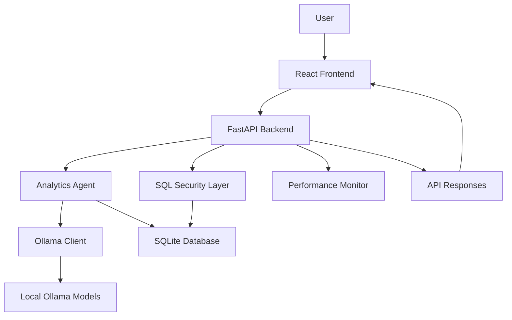

# ORBIT — Local AI-Powered Analytics Agent

ORBIT is a local AI-powered analytics platform that allows users to explore data, ask questions in natural language, generate analytical insights, and execute read-only SQL queries through an interactive interface.

It combines a React and TypeScript frontend with a FastAPI backend, SQLite database, and locally hosted Ollama language models.

The project focuses on practical analytics workflows, SQL safety, local AI inference, performance monitoring, and reliable execution.

---

## Screenshots

### 1. Analytics Studio


### 2. Analysis Results


### 3. Query Performance


### 4. Performance Dashboard


### 5. Performance History


### 6. Data Sources


### 7. SQL Explorer


---

## Key Features

### AI-Powered Analytics
- Ask questions about data using natural language.
- Generate analytical insights using locally hosted Ollama models.
- Support AI-assisted analysis workflows.
- Provide deterministic fallback responses when AI inference is unavailable.
- Cache accepted AI responses to reduce repeated model-generation work.

### SQL Explorer
- Execute read-only SQL queries.
- Validate SQL statements before execution.
- Restrict unsafe database operations.
- Explore query results through the interface.

### Interactive Analytics Dashboard
- Visualize analytical results using charts.
- View query execution information.
- Explore data through an interactive interface.

### Performance Monitoring
- Monitor API request counts.
- Track workflow success and failure.
- Measure average and P95 API latency.
- Track SQL execution time and AI generation time.
- Monitor cache hits and misses.
- Inspect recent request history.

### Security and Reliability
- Read-only SQL validation.
- Environment-based configuration.
- Bounded in-memory performance history.
- Singleflight protection for concurrent requests.
- Automated backend tests.

---

## Architecture



### Technology Stack

| Layer | Technologies |
|---|---|
| Frontend | React 18, TypeScript, Vite |
| UI | CSS, Lucide React |
| Charts | Recharts |
| Backend | Python, FastAPI |
| Database | SQLite |
| AI Models | Ollama |
| LLMs | Qwen 2.5 1.5B, Llama 3.2 3B |
| Embeddings | nomic-embed-text |
| Testing | Pytest |
| Deployment | Docker, Docker Compose |

---

## Project Structure

```text
ORBIT/
│
├── backend/
│   ├── app/
│   │   ├── agents.py
│   │   ├── database.py
│   │   ├── main.py
│   │   ├── security.py
│   │   └── ollama_client.py
│   │
│   ├── tests/
│   │   ├── test_security.py
│   │   ├── test_performance.py
│   │   └── test_singleflight.py
│   │
│   ├── benchmark_ollama.py
│   ├── benchmark_queries.py
│   └── requirements.txt
│
├── frontend/
│   ├── src/
│   │   ├── components/
│   │   │   └── AnalyticsChart.tsx
│   │   ├── App.tsx
│   │   ├── main.tsx
│   │   └── styles.css
│   │
│   ├── package.json
│   └── vite.config.ts
│
├── docs/
│   ├── screenshots/
│   │   ├── 01-analytics-studio.png
│   │   ├── 02-analysis-results.png
│   │   ├── 03-query-performance.png
│   │   ├── 04-performance-dashboard.png
│   │   ├── 05-performance-history.png
│   │   ├── 06-data-sources.png
│   │   └── 07-sql-explorer.png
│   │
│   └── RELEASE_NOTES.md
│
├── .env.example
├── .gitignore
├── docker-compose.yml
└── README.md
```

---

## Prerequisites

Install the following before running ORBIT:

- Python 3.10
- Node.js 20+
- npm
- Ollama
- Git

### Ollama Models

Install Ollama from:

https://ollama.com/

Pull the required models:

```bash
ollama pull qwen2.5:1.5b
ollama pull llama3.2:3b
ollama pull nomic-embed-text
```

Make sure Ollama is running before starting AI-powered workflows.

---

## Installation and Setup

### 1. Clone the Repository

```bash
git clone https://github.com/Nithish464/orbit-analytics-agent.git
cd orbit-analytics-agent
```

### 2. Backend Setup

Open a terminal:

```bash
cd backend
```

Create a virtual environment:

```bash
python -m venv .venv
```

Activate it on Windows CMD:

```cmd
.venv\Scripts\activate
```

Install dependencies:

```bash
pip install -r requirements.txt
```

### 3. Environment Configuration

Return to the project root and create your local environment file:

```cmd
cd ..
copy .env.example .env
```

Configure the environment variables according to your local setup.

Do not commit actual credentials, API keys, or secrets.

### 4. Start the Backend

```cmd
cd backend
.venv\Scripts\activate
python -m uvicorn app.main:app --reload
```

Backend:

```text
http://127.0.0.1:8000
```

API documentation:

```text
http://127.0.0.1:8000/docs
```

### 5. Frontend Setup

Open another terminal:

```cmd
cd frontend
npm install
npm run dev
```

Open the frontend URL printed by Vite, normally:

```text
http://localhost:5173
```

---

## Performance Monitoring

ORBIT includes a performance monitoring system that tracks application activity.

| Metric | Description |
|---|---|
| Total Requests | Number of recorded API requests |
| Workflow Success | Successful workflow executions |
| Average API Latency | Average API response time |
| P95 Latency | 95th percentile API response time |
| SQL Execution Time | Database query execution duration |
| AI Generation Time | Time spent generating AI responses |
| Cache Hits | Number of responses served from cache |
| Cache Misses | Number of requests requiring fresh processing |

Performance metrics are maintained in bounded in-memory storage and reset when the backend restarts.

The performance API is available at:

```text
GET /api/performance
```

---

## Benchmark Results

### SQL Query Benchmarks

Sample local benchmark results:

| Query | Execution Time |
|---|---:|
| Year Filter | 0.0490 ms |
| Customer Join | 0.0619 ms |
| Order Join | 0.0418 ms |
| Product Join | 0.0769 ms |

### AI Response Cache Benchmark

A local synthetic benchmark demonstrated:

- First model generation: approximately 12.6 seconds.
- Repeated accepted-answer cache hits: under 0.4 seconds.

These are local benchmark observations, not production performance guarantees. Actual results depend on hardware, model loading, data size, and workload.

---

## Running Tests

Activate the backend virtual environment:

```cmd
cd backend
.venv\Scripts\activate
```

Run the test suite:

```bash
python -m pytest -v
```

The previously verified backend test suite completed with **23 passing tests**.

Tests cover areas including:

- SQL security validation.
- Performance monitoring.
- Singleflight/concurrent request handling.
- Workflow behavior.

---

## Security

ORBIT includes several safety mechanisms:

- Read-only SQL query validation.
- Rejection of unsafe SQL operations.
- Environment-based configuration.
- No hardcoded production credentials.
- Bounded performance history.
- Automated security tests.

**Important:** This project is intended for local development and demonstration. Review authentication, authorization, network exposure, and deployment security before using it with sensitive or production data.

---

## Limitations

- AI generation speed depends on the local machine and selected Ollama model.
- Performance history is in-memory and resets after backend restart.
- Local benchmark results may vary across machines.
- Deterministic fallback responses are not equivalent to LLM-generated insights.
- The project is currently intended as a local analytics demonstration rather than a production-ready multi-user platform.

---

## Future Improvements

- Add more data-source integrations.
- Expand analytics and visualization capabilities.
- Improve model selection and inference optimization.
- Add persistent performance history.
- Introduce authentication and role-based access control.
- Expand automated testing and deployment workflows.

---

## Author

**Nithishkumar K**

GitHub: https://github.com/Nithish464

Project Repository: https://github.com/Nithish464/orbit-analytics-agent

---

## License

No license is specified yet. All rights are reserved by the author unless a license is added to this repository.